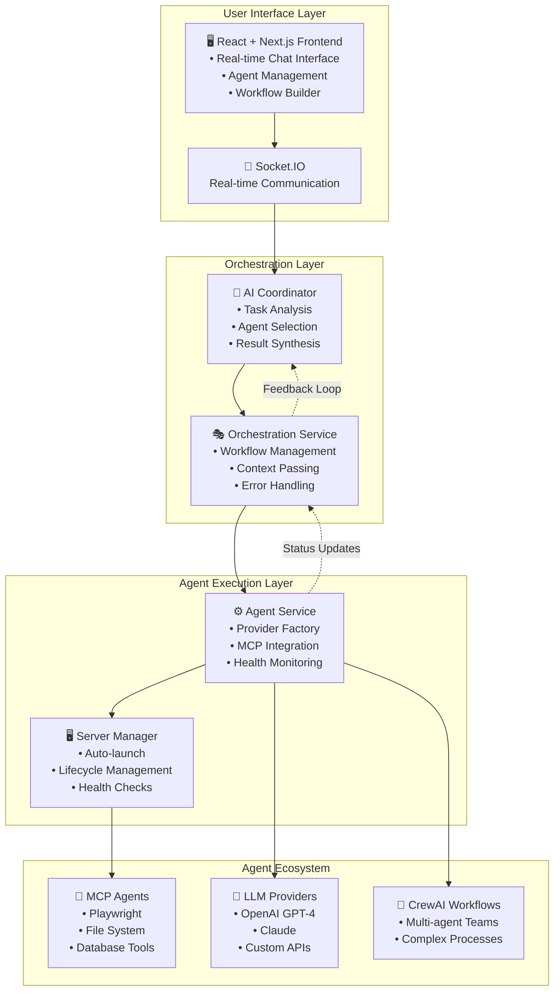
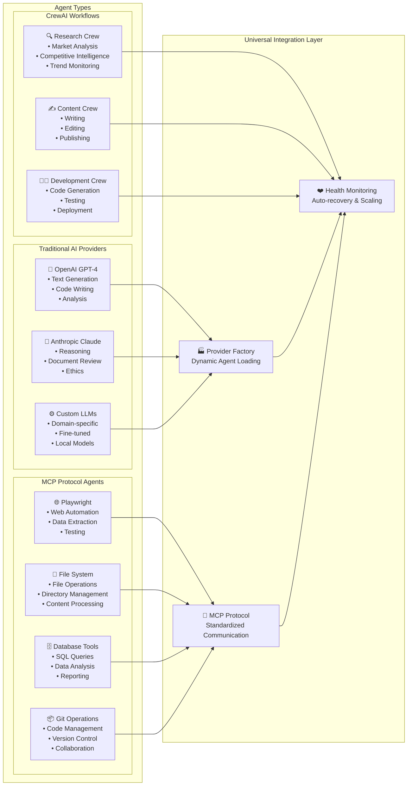
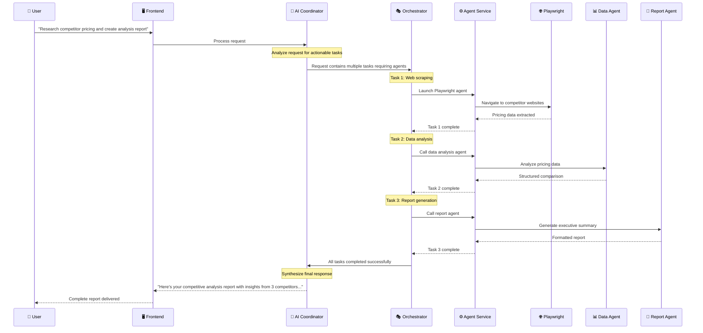
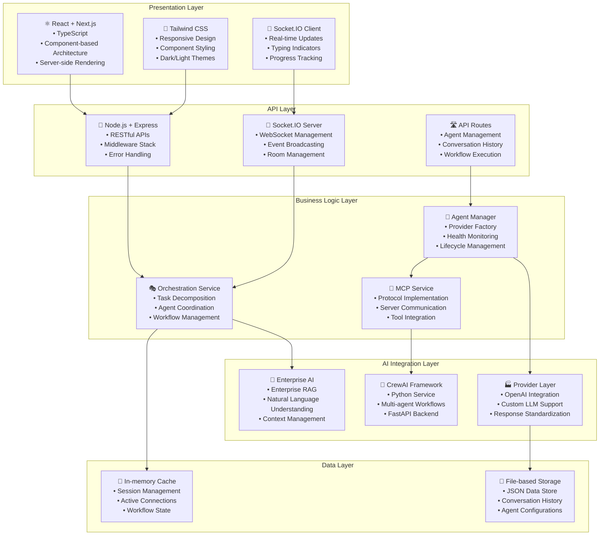
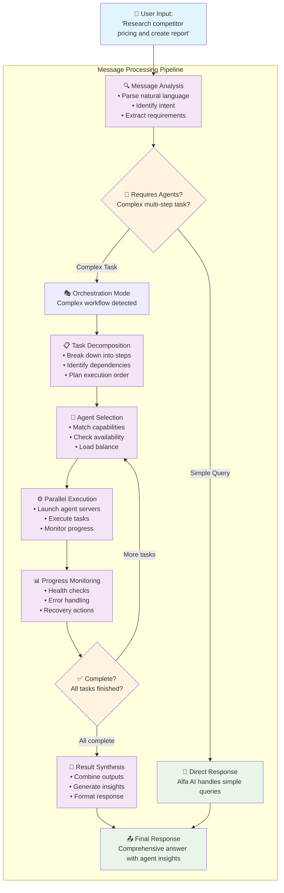

# 🤖 AI Guru Studio: Intelligent Multi-Agent Orchestration Platform

## 🌟 The Big Idea

**AI Guru Studio** is a revolutionary platform that transforms how businesses interact with AI by creating an intelligent orchestration layer that coordinates multiple specialized AI agents to solve complex, multi-step tasks through natural conversation.

Instead of juggling multiple AI tools separately, users can describe their complete workflow in plain English, and our platform automatically:
- **Decomposes** complex requests into actionable tasks
- **Selects** the best-suited agents for each task
- **Coordinates** execution across different AI systems
- **Synthesizes** results into a cohesive response

## 🎯 Problem Statement

**Current Challenge:** Businesses today struggle with AI tool fragmentation - they have access to powerful AI capabilities (GPT-4 for text, Playwright for web automation, specialized APIs for data processing), but no unified way to coordinate them for complex workflows.

**Real Impact:** Teams waste hours manually switching between tools, copying outputs, and managing multi-step processes that should be automated.

## 💡 Our Solution

### **Intelligent Agent Orchestration**
Our platform uses an **Enterprise AI Coordinator** as a central intelligence that can understand complex business requests and automatically:

1. **Analyze** user requests to identify required tasks
2. **Select** appropriate specialized agents from an ecosystem of tools
3. **Execute** tasks in the correct sequence with proper context passing
4. **Monitor** completion and handle failures gracefully
5. **Synthesize** results into actionable insights

### **System Architecture**



### **Universal Agent Ecosystem**
- **Traditional AI Providers**: OpenAI GPT-4, Claude, custom LLMs
- **MCP Protocol Support**: Standardized integration with tools like Playwright, database connectors, file systems
- **CrewAI Workflows**: Multi-agent collaborative processes
- **Custom APIs**: Any REST API can become an intelligent agent

### **Agent Ecosystem**



## 🚀 Compelling Use Case Example

**Scenario:** *"Research our top 3 competitors' pricing pages, extract their pricing data, compare it with our current pricing, and generate a competitive analysis report for next week's board meeting."*

### **Traditional Approach:**
1. ⏰ **2 hours**: Manually visit competitor websites
2. ⏰ **1 hour**: Copy pricing data to spreadsheet  
3. ⏰ **1 hour**: Create comparison analysis
4. ⏰ **1 hour**: Format report for presentation
5. **Total: 5 hours of manual work**

### **AI Guru Studio Approach:**
```
User: "Research our top 3 competitors' pricing pages, extract their pricing data, 
       compare it with our current pricing, and generate a competitive analysis 
       report for next week's board meeting."

🤖 AI Coordinator:
├── 🌐 @PlaywrightAgent → Navigate and extract competitor pricing data
├── 📊 @DataAnalysisAgent → Structure and compare pricing information  
├── 📝 @ReportAgent → Generate executive summary with insights
└── 📧 @EmailAgent → Format and send to stakeholders

✅ Complete workflow executed in 3 minutes
```

### **Workflow Execution Flow**



## 🛠️ Technology Stack

### **Frontend Excellence**
- **React + Next.js**: Modern, responsive user interface
- **TypeScript**: Type-safe development
- **Socket.IO**: Real-time collaboration and progress tracking
- **Tailwind CSS**: Beautiful, consistent design system

### **Backend Intelligence**
- **Node.js + Express**: Robust API layer
- **Intelligent Orchestration Service**: Custom-built task decomposition and agent coordination
- **Agent Server Management**: Automatic lifecycle management of specialized tools

### **AI Integration**
- **Enterprise AI**: RAG-enabled coordination intelligence
- **OpenAI API**: GPT-4 integration for general intelligence
- **CrewAI Framework**: Python-based multi-agent workflows
- **Model Context Protocol (MCP)**: Standardized tool integration

### **Infrastructure**
- **WebSocket Communication**: Real-time updates and collaboration
- **File-based Storage**: Simple deployment and data persistence
- **Docker Ready**: Containerized deployment support

### **Technology Stack Architecture**



## 🔄 Intelligent Message Processing Pipeline

Our platform processes user requests through a sophisticated pipeline that automatically determines the best execution strategy:



## 🎯 Key Technical Innovations

### **1. Intelligent Task Decomposition**
Our orchestrator analyzes natural language requests and automatically identifies:
- Required capabilities
- Task dependencies
- Optimal execution sequence
- Context passing requirements

### **2. Dynamic Agent Selection**
Smart agent matching based on:
- Task requirements vs. agent capabilities
- Agent availability and health status
- Historical performance data
- Load balancing across resources

### **3. Universal Protocol Support**
- **MCP Integration**: Standardized way to connect any AI tool
- **Provider Factory Pattern**: Seamless integration of different AI services
- **Real-time Agent Management**: Automatic server lifecycle management

### **4. Fault-Tolerant Execution**
- Automatic agent health monitoring
- Graceful failure handling and recovery
- Task retry mechanisms
- Progress preservation during interruptions

## 🏆 Competitive Advantages

### **🧠 Intelligence-First Design**
Unlike simple chatbot interfaces, our platform provides genuine intelligence coordination - understanding context, managing state, and optimizing workflows.

### **🔌 Universal Connectivity**
Our MCP integration and provider factory pattern mean any AI tool or API can become part of the ecosystem without custom development.

### **⚡ Enterprise Ready**
Built with enterprise AI infrastructure, providing security, scalability, and reliability for business-critical workflows.

### **🎨 Developer & User Friendly**
- Natural language workflow creation
- Visual workflow management
- Real-time collaboration features
- Comprehensive API for integration

## 📈 Market Impact & Scalability

### **Target Market**
- **SME Businesses**: Automate complex workflows without technical teams
- **Enterprise**: Coordinate existing AI investments more effectively  
- **Development Teams**: Rapid AI application prototyping
- **Consultancies**: Deliver AI solutions faster to clients

### **Revenue Potential**
- **SaaS Model**: Per-seat subscription with usage-based pricing
- **Enterprise Licensing**: On-premise deployments
- **Marketplace**: Revenue share from third-party agent integrations
- **Professional Services**: Custom workflow development

### **Scalability**
- **Horizontal**: Add more agent types and integrations
- **Vertical**: Industry-specific agent packages (legal, finance, marketing)
- **Global**: Multi-language support and regional AI providers

## 🚀 What Makes This Hackathon-Worthy

### **1. Complete Working Platform**
Not just a concept - we have a fully functional platform with real agent coordination, beautiful UI, and robust backend infrastructure.

### **2. Cutting-Edge Technology Integration**
We're among the first to implement MCP protocol support and intelligent orchestration at this scale.

### **3. Real Business Value**
Solves genuine pain points that every business faces when trying to coordinate multiple AI tools.

### **4. Extensible Architecture**
Platform designed for growth - easy to add new agents, providers, and capabilities.

### **5. Demo-Ready**
Live demonstration of complex workflows being executed through simple conversational interface.

## 🎬 Live Demo & Repository

### **GitHub Repository**
- **Frontend**: React + Next.js with beautiful UI components
- **Backend**: Node.js + Express with intelligent orchestration
- **Python Service**: CrewAI integration with FastAPI
- **Documentation**: Comprehensive guides and API documentation

### **Demo Scenarios**
1. **Competitive Analysis**: Research competitors → Extract data → Generate report
2. **Content Pipeline**: Web scraping → Data analysis → Content generation
3. **Development Workflow**: Code analysis → Testing → Deployment coordination

### **Live Demo Features**
- Real-time agent orchestration visualization
- Interactive workflow builder
- Agent health monitoring dashboard
- Multi-agent conversation examples

## 🚀 Future Roadmap

### **Phase 1: Enhanced Intelligence (Next 3 months)**
- **Advanced Task Planning**: Multi-step dependency resolution
- **Context Persistence**: Long-running workflow state management
- **Predictive Agent Selection**: ML-based capability matching
- **Custom Workflow Templates**: Industry-specific automation patterns

### **Phase 2: Enterprise Features (3-6 months)**
- **Multi-tenant Architecture**: Secure organization boundaries
- **Advanced Analytics**: Performance metrics and optimization insights
- **Integration Marketplace**: Third-party agent ecosystem
- **Enterprise Security**: SSO, audit logs, compliance features

### **Phase 3: Scale & Intelligence (6-12 months)**
- **AI-powered Workflow Generation**: Automatically create workflows from examples
- **Cross-organizational Collaboration**: Shared agent marketplaces
- **Mobile Applications**: Native iOS/Android apps
- **Global Deployment**: Multi-region, multi-language support

## 💰 Business Model & Market Opportunity

### **Revenue Streams**
1. **SaaS Subscriptions**: $29-299/month per organization
2. **Usage-based Pricing**: $0.01-0.10 per agent call
3. **Enterprise Licensing**: $10K-100K annual contracts
4. **Marketplace Revenue**: 15-30% commission on third-party agents
5. **Professional Services**: Custom workflow development

### **Market Size**
- **TAM**: $50B (Enterprise Software Automation)
- **SAM**: $8B (AI/ML Platforms & Tools)
- **SOM**: $800M (Multi-agent Orchestration Platforms)

### **Competitive Advantages**
- **First-mover**: Early MCP protocol adoption
- **Enterprise-ready**: Built on proven AI infrastructure
- **Universal Connectivity**: Works with any AI tool or API
- **Natural Language Interface**: No coding required

## 👥 Team & Next Steps

### **Core Team Expertise**
- **AI/ML Engineering**: Deep experience with LLM orchestration
- **Full-stack Development**: Modern web technologies and scalable backends
- **Enterprise Software**: Business process automation and integration
- **Product Design**: User experience and interface design

### **Immediate Next Steps**
1. **Beta Testing Program**: 10-50 pilot customers
2. **Agent Marketplace Development**: Third-party integrations
3. **Series A Funding**: Scale engineering and go-to-market
4. **Partnership Program**: AI provider and systems integrator relationships

## 🏆 Why We'll Win This Hackathon

### **Technical Excellence**
- **Complete Platform**: Not just a prototype, but a production-ready system
- **Innovative Architecture**: Pioneering intelligent agent orchestration
- **Real Business Value**: Solving genuine enterprise pain points

### **Market Readiness**
- **Proven Technology Stack**: Built on battle-tested enterprise components
- **Clear Go-to-market Strategy**: Defined customer segments and pricing
- **Scalable Business Model**: Multiple revenue streams and growth vectors

### **Demo Impact**
- **Compelling Use Cases**: Real-world scenarios with measurable ROI
- **Beautiful User Experience**: Intuitive interface that "just works"
- **Technical Depth**: Sophisticated architecture with elegant simplicity

---

**AI Guru Studio** represents the future of human-AI collaboration - where complex business processes become as simple as having a conversation with an intelligent coordinator who knows exactly which experts to consult and how to get things done.

*Ready to transform how your business works with AI?*

---

## 📞 Contact Information

**Project Repository**: [AI Guru Studio](https://github.com/your-org/ai-guru-studio)  
**Live Demo**: [demo.ai-guru-studio.com](https://demo.ai-guru-studio.com)  
**Team Email**: team@ai-guru-studio.com  
**Pitch Deck**: [AI Guru Studio - Hackathon Pitch](https://slides.ai-guru-studio.com) 