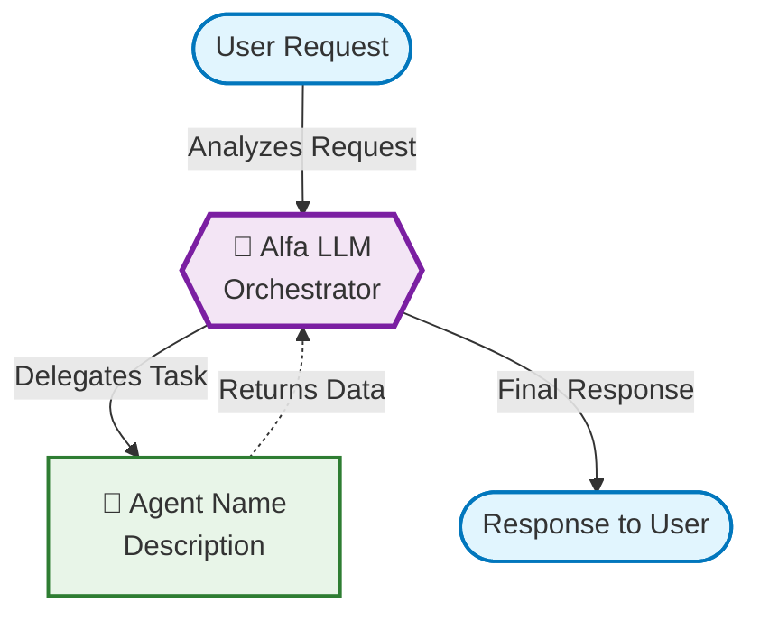

# Flowchart Feature Documentation

## Overview

The AI Guru Studio now includes a beautiful flowchart generation feature that visualizes how the Alfa LLM orchestrates various agents to complete user requests. This feature helps users understand the workflow and data flow between agents.

## Features

### 🎯 Smart Agent Detection
- **Automatic Recognition**: Detects `@agentName` mentions in user input
- **Intelligent Inference**: Analyzes text to suggest relevant agents when none are mentioned
- **Real-time Validation**: Only shows agents that are currently active and available

### 🎨 Beautiful Visualizations
- **Mermaid.js Integration**: Uses industry-standard Mermaid syntax for flowcharts
- **Responsive Design**: Adapts to different screen sizes (mobile, tablet, desktop)
- **Color-coded Nodes**: Different colors for start/end, Alfa LLM, agents, and decisions
- **Interactive Elements**: Copy, download, and regenerate functionality

### 🔄 Dual Mode Interface
- **Chat Mode**: Traditional conversational interface
- **Flowchart Mode**: Visual workflow representation
- **Seamless Toggle**: Switch between modes without losing context
- **Synchronized Input**: Same input field works for both modes

## How to Use

### 1. Toggle to Flowchart Mode
Click the "Flowchart" button in the header to switch from Chat mode to Flowchart mode.

### 2. Enter Your Workflow
Type a message describing your workflow. Examples:
- `"Visit GitHub.com and tell me what's featured"`
- `"@playwright navigate to the website and @data-extractor analyze the content"`
- `"Fetch data from the API, process it, then generate a report"`

### 3. Generate Flowchart
Click the flowchart button (📊) next to the send button to generate your visualization.

## Flowchart Components

### Node Types
- **🎯 Start**: User request entry point (stadium shape)
- **🧠 Alfa LLM**: Central orchestrator (hexagon shape, purple)
- **🤖 Agents**: MCP agents and tools (rectangle shape, green)
- **💎 Decisions**: Conditional logic points (diamond shape, orange)
- **🏁 End**: Final response to user (stadium shape, blue)

### Connection Types
- **Solid Arrows**: Task delegation from Alfa to agents
- **Dashed Arrows**: Data flow back to Alfa from agents
- **Labeled Edges**: Describe the type of interaction

## Agent Detection Logic

### Explicit Mentions
When you use `@agentName`, the system:
1. Validates the agent exists and is active
2. Includes it in the flowchart with proper metadata
3. Shows bidirectional communication with Alfa LLM

### Intelligent Inference
When no agents are mentioned, the system analyzes your text for:
- **Web keywords** → Browser/Playwright agent
- **GitHub/Git keywords** → GitHub agent  
- **Data/Database keywords** → Data processing agents
- **File operations** → Filesystem agents
- **API mentions** → API calling agents

### Conditional Logic Detection
The system detects conditional keywords like:
- if, then, else, when, unless, while, until

This adds decision nodes to show branching logic in workflows.

## Technical Implementation

### Technologies Used
- **Mermaid.js**: Flowchart rendering engine
- **React**: Component-based UI
- **TypeScript**: Type-safe development
- **Framer Motion**: Smooth animations
- **Tailwind CSS**: Responsive styling

### Key Components
- `FlowchartGenerator.tsx`: Main flowchart logic and rendering
- `ChatInterface.tsx`: Updated with mode toggle and flowchart integration
- Mermaid CSS: Custom styling for beautiful diagrams

### Mermaid Syntax Generated

## Export Features

### Copy to Clipboard
Click the copy button to get the raw Mermaid syntax for use in other tools.

### Download as .mmd File
Click the download button to save the flowchart as a Mermaid file for external use.

### Regenerate
Click the refresh button to regenerate the flowchart with the current input.

## Examples

### Simple Web Navigation
**Input**: `"Visit GitHub.com and extract the featured repositories"`

**Generated Flowchart**:
- User Request → Alfa LLM → Browser Agent → Alfa LLM → Response

### Multi-Agent Workflow
**Input**: `"@playwright visit the site, @data-extractor analyze content, then @report-generator create summary"`

**Generated Flowchart**:
- User Request → Alfa LLM → Playwright Agent → Alfa LLM
- Alfa LLM → Data Extractor → Alfa LLM  
- Alfa LLM → Report Generator → Alfa LLM → Response

### Conditional Workflow
**Input**: `"If the API returns data, process it with @data-processor, otherwise use @fallback-handler"`

**Generated Flowchart**:
- User Request → Alfa LLM → Decision Node → Multiple Agent Paths → Alfa LLM → Response

## Troubleshooting

### Flowchart Not Rendering
1. Check browser console for Mermaid errors
2. Ensure input contains actionable workflow descriptions
3. Try refreshing the page

### Agent Not Detected
1. Verify agent name spelling matches exactly
2. Check that the agent is active in the system
3. Use explicit `@agentName` syntax

### Performance Issues
1. Complex flowcharts may take a moment to render
2. Try simplifying the workflow description
3. Use fewer agents in a single request

## Future Enhancements

- **Interactive Nodes**: Click to see agent details
- **Real-time Updates**: Live flowchart updates as workflow executes
- **Export Formats**: PDF, PNG, SVG export options
- **Workflow Templates**: Pre-built common workflow patterns
- **Collaboration**: Share flowcharts with team members

## References

- [Mermaid.js Documentation](https://mermaid.js.org/syntax/flowchart.html)
- [MCP Agent Documentation](../MCP_INTEGRATION_GUIDE.md)
- [Orchestrator Guide](../ORCHESTRATOR_GUIDE.md) 